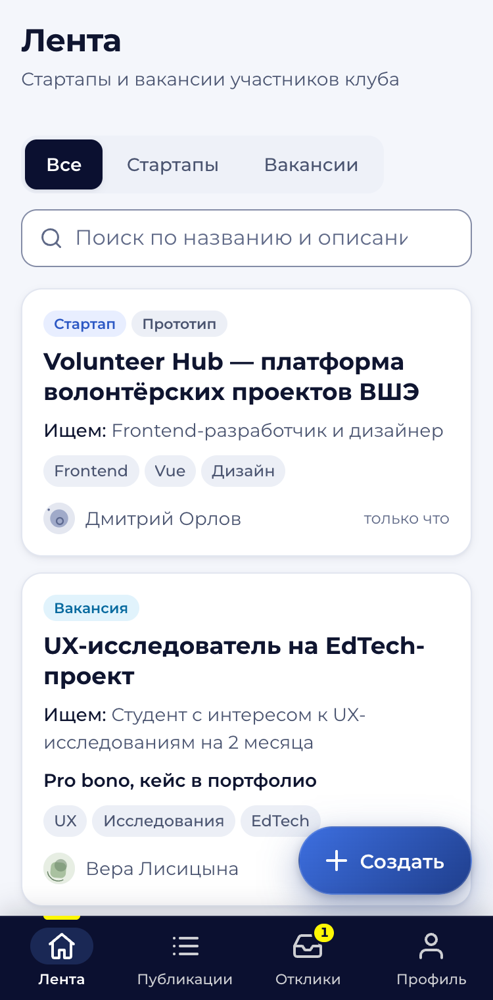
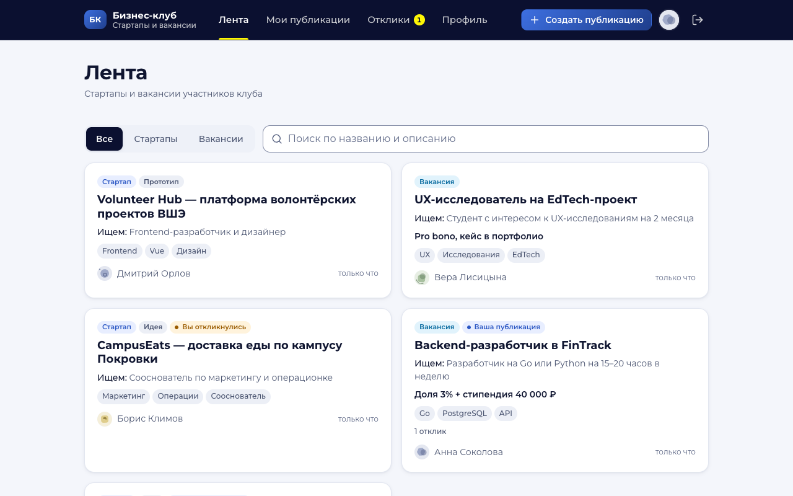
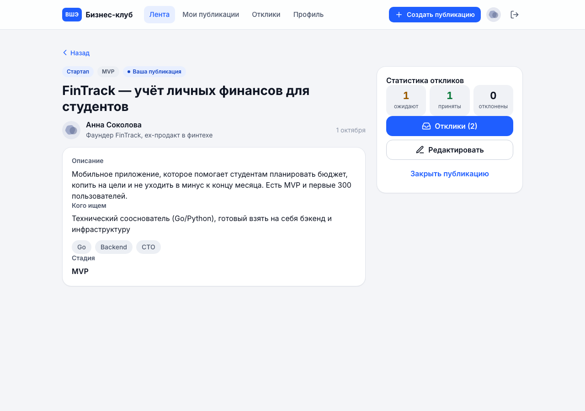

# Бизнес-клуб НИУ ВШЭ: стартапы и вакансии

Прототип модуля «Стартапы и вакансии» для будущего Telegram mini-app Бизнес-клуба НИУ ВШЭ.
Участники публикуют стартапы и вакансии, смотрят ленту и откликаются. Автор принимает
или отклоняет отклики, откликнувшийся видит решение в личном кабинете. Бэкенд написан на
Go и PostgreSQL, фронтенд на Nuxt 4 (Vue 3, TypeScript, SSR). Всё запускается одной
командой в Docker Compose.

- Исходное ТЗ: [Google Docs](https://docs.google.com/document/d/19PrrbstXrUcBN78HO_rAlZRkWVS7aEvRo0-gxDmczQk).
- Продукт, домен, данные и правила: [`SPEC.md`](SPEC.md). Контракт API:
  [`back/api/hbc/v1/hbc.proto`](back/api/hbc/v1/hbc.proto). Архитектура бэкенда:
  [`back/ARCHITECTURE.md`](back/ARCHITECTURE.md).

| Телефон (375 px) | Компьютер (1280 px) |
|---|---|
|  | <br> |

Остальные экраны, в том числе в тёмной теме, лежат в [`front/docs/screenshots/`](front/docs/screenshots/).

## Содержание

1. [Запуск](#запуск)
2. [Тестовые аккаунты](#тестовые-аккаунты)
3. [Сценарий проверки](#сценарий-проверки)
4. [Архитектура и решения](#архитектура-и-решения)
5. [Тесты](#тесты)
6. [Известные ограничения](#известные-ограничения)
7. [Работа с ИИ](#работа-с-ии)
8. [Потраченное время](#потраченное-время)
9. [Деплой](#деплой)

## Запуск

Нужны Docker с Compose v2 и `make`. Для `make smoke` дополнительно нужны `curl` и `jq`.

```sh
make up          # = docker compose up -d --build --wait
```

Без `make` подойдёт `docker compose up --build`. Файл `.env` не обязателен: у всех
переменных в `docker-compose.yaml` есть демо-значения. Чтобы их поменять, скопируйте
`cp .env.example .env` и отредактируйте (подробнее в разделе [Безопасность](#безопасность)).

Первая сборка образов идёт 1–2 минуты, повторный старт занимает около 20 секунд. При
старте контейнер бэкенда применяет миграции (goose из `back/migrations/`, затем стартует
приложение) и загружает демо-данные.
Если стек поднимался до перехода на goose-миграции (старые тома), один раз выполните
`make reset && make up`.

| Что | Адрес |
|---|---|
| Приложение (фронт) | http://localhost:3000 |
| API (`/v1/...`, `/readyz`) | http://localhost:8080 |
| Swagger UI | http://localhost:8081/docs/ |
| Метрики Prometheus | http://localhost:8081/metrics |

Порты 8080 и 8081 открыты только для удобства проверки. В продакшене наружу смотрит
только фронт (SPEC §5).

| Команда | Что делает |
|---|---|
| `make up` | собирает образы и поднимает `db`, `minio`, `back`, `front`; ждёт healthcheck |
| `make obs` | то же плюс наблюдаемость: Jaeger http://localhost:16686, Prometheus http://localhost:9090, консоль MinIO http://localhost:9001 (логин и пароль `minioadmin`); бэкенд отправляет трейсы |
| `make smoke` | smoke-тест запущенного стека: основной сценарий через API, фото через MinIO, вход через фронт |
| `make down` | останавливает контейнеры, данные сохраняются |
| `make reset` | останавливает контейнеры и удаляет тома: базу (`db_data`) и фото (`minio_data`). Следующий `make up` снова загрузит демо-данные |
| `make logs` | логи всех сервисов |
| `make test`, `make lint` | тесты и линтеры бэка и фронта, см. [Тесты](#тесты) |
| `make help` | список целей |

Локальная разработка без Docker описана в [`back/README.md`](back/README.md) (Go,
`make run`, тестовое окружение) и [`front/README.md`](front/README.md) (`npm run dev`,
mock-режим без бэкенда).

### Если порты заняты

Положите в корень файл `docker-compose.override.yaml` (он в `.gitignore`). Compose
подхватит его сам, если не передавать `COMPOSE_FILES`. Тег `!override` требует Compose
2.24.4 или новее.

```yaml
services:
  back:
    environment:
      CORS_ORIGINS: http://localhost:13000
    ports: !override
      - "18080:8080"
      - "18081:8081"
  front:
    ports: !override
      - "13000:3000"
```

```sh
make up
make smoke API_URL=http://localhost:18080 FRONT_URL=http://localhost:13000
```

Можно хранить файл в другом месте и передавать его явно:
`make up COMPOSE_FILES=/path/to/ports.override.yaml`. Тот же параметр нужен для `make obs`,
`make down` и `make reset`. Compose также учитывает `COMPOSE_FILE` и `COMPOSE_PROJECT_NAME`
из окружения: с отдельным именем проекта стек не пересечётся с другим запущенным. Порты
Jaeger (16686, 4317), Prometheus (9090) и консоли MinIO (9001) переопределяются так же.

### Если сборка упала на сети

Docker Hub иногда обрывает соединение при первой загрузке базовых образов
(`Head "https://registry-1.docker.io/...": EOF`). Повторите `make up`: слои, которые уже
скачались, берутся из кэша.

## Тестовые аккаунты

Пароль у всех: **`demo1234`**. На странице входа есть кнопки «Войти как …», вводить
логин не нужно. Своего пользователя можно завести через регистрацию.

| Логин | Имя | Кто | Что видно после входа |
|---|---|---|---|
| `anna` | Анна Соколова | фаундер FinTrack | **Начните с неё.** Две публикации со статистикой: стартап FinTrack с ожидающим откликом Бориса и принятым откликом Веры, вакансия с отклонённым откликом Дмитрия. Счётчик «Отклики» в навигации. Свой отклик на CampusEats в статусе «Ожидает» |
| `boris` | Борис Климов | backend-разработчик | Отправленные отклики: на FinTrack («Ожидает») и на закрытую вакансию Volunteer Hub («Принят»). Свой стартап CampusEats с ожидающим откликом Анны |
| `vera` | Вера Лисицына | продуктовый дизайнер | Принятый отклик на FinTrack и отозванный отклик на стартап Volunteer Hub: на него можно откликнуться заново. Вакансия без откликов |
| `dmitry` | Дмитрий Орлов | маркетолог | Отклонённый отклик на вакансию FinTrack. Закрытая вакансия с принятым откликом: её нет в ленте, но она открывается по ссылке и видна во вкладке «Закрытые» |

Полный набор демо-данных описан в SPEC §6. В ленте 5 активных публикаций, шестая закрыта.
Идентификаторы генерируются при каждом `make reset`, поэтому стабильные ключи — логин и
название публикации.

## Сценарий проверки

Основной сценарий из ТЗ (SPEC §1): Анна публикует стартап, Борис находит его и
откликается, Анна принимает отклик, Борис видит «принят». Удобно открыть два окна: обычное
для Анны и приватное для Бориса. Сценарий одинаково проходится на телефоне и на компьютере.

1. Откройте http://localhost:3000. Без входа приложение перенаправит на `/login`. Нажмите
   «Войти как Анна».
2. Нажмите «Создать публикацию» (на телефоне кнопка «Создать»). Выберите «Стартап»,
   заполните название, описание, кого ищете, теги и стадию. Пустые поля и слишком короткий
   текст подсвечиваются ошибками на русском. Нажмите «Опубликовать».
3. Откроется страница публикации со статистикой откликов: пока везде нули. Рядом кнопки
   «Редактировать» и «Закрыть публикацию».
4. Во втором окне войдите как Борис. Найдите стартап в ленте: переключите фильтр на
   «Стартапы» и введите в поиск слово из названия.
5. Откройте публикацию, нажмите «Откликнуться», напишите сообщение и отправьте. Статус
   станет «Ожидает». Если отправить отклик ещё раз, например из другой вкладки, сервер
   ответит «Вы уже откликались на эту публикацию».
6. Анна: на счётчике «Отклики» в навигации прибавилась единица. Откройте публикацию,
   затем «Отклики», и нажмите «Принять». Принимать и отклонять можно и на вкладке
   «Полученные» раздела «Отклики».
7. Борис: в разделе «Отклики → Отправленные» отклик в статусе «Принят». На странице
   публикации написано «Автор принял ваш отклик» и есть ссылка на Telegram автора.
8. Повторные и запрещённые действия. Под Анной откройте свою публикацию: кнопки
   «Откликнуться» нет. Закройте публикацию: она пропадёт из ленты Бориса и останется
   доступна по ссылке с пометкой «Публикация закрыта», откликнуться на неё нельзя.
9. Отзыв и повторный отклик. Войдите как Вера и откройте стартап Volunteer Hub. Свой
   прошлый отклик она отозвала, поэтому кнопка «Откликнуться» снова доступна. После
   отклика в «Отклики → Отправленные» видны обе записи: «Отозван» и «Ожидает».
10. Профиль. В «Профиле» измените имя, навыки и Telegram, загрузите фото (JPEG, PNG или
    WebP, до 5 МБ). Фото заменит сгенерированный аватар на всех экранах. После удаления
    фото вернётся сгенерированный аватар.

Тот же сценарий через API проверяет `make smoke` (16 проверок, несколько секунд):

```
Smoke-тест: API http://localhost:8080, фронт http://localhost:3000
 1. API отвечает (GET /v1/ping, /readyz) ... OK
 ...
16. фронт: вход через Nitro, httpOnly-cookie, прокси /api/v1/me ... OK
Smoke-тест пройден: 16 проверок.
```

Smoke создаёт свою публикацию, а в конце удаляет фото и закрывает публикацию. Закрытая
публикация «Smoke … — стартап для проверки» остаётся у Анны. Если нужен чистый стенд,
запускайте smoke после ручной проверки или сделайте `make reset && make up`.

Методы API можно вызывать из Swagger UI (http://localhost:8081/docs/). Access-токен выдаёт
`POST /v1/auth/login` (поле `accessToken`), его нужно вставить в «Authorize» в виде
`Bearer <accessToken>`. Он живёт 15 минут, новую пару даёт `POST /v1/auth/refresh`.

## Архитектура и решения

### Репозиторий

```
├── SPEC.md, PLAN.md, CLAUDE.md   продукт и правила, план задач, указания агентам
├── tasks/                        задания B*/F*/I*, отчёты (reports/), решения (DECISIONS.md)
├── docker-compose.yaml           db + minio + back + front, профиль observability
├── config/, .kamal/              деплой стенда через Kamal (см. «Деплой»), .env.deploy.example
├── Makefile, scripts/smoke.sh    запуск, тесты, smoke
├── back/                         Go: модульный монолит (gRPC + grpc-gateway)
└── front/                        Nuxt 4: SSR, TSX, своя библиотека аватаров lib/blob-avatar
```

Бэкенд и фронтенд лежат в одном репозитории (монорепо). Так контракт API, генерация
клиента, compose и тесты меняются одним коммитом.

### Контракт API: proto

Единственный источник API — [`hbc.proto`](back/api/hbc/v1/hbc.proto) (22 RPC). По нему
`buf generate` создаёт Go-код gRPC-сервера, HTTP/JSON-шлюз (grpc-gateway) и
`hbc.swagger.json`. Из swagger фронт генерирует типизированный TS-клиент
(`npm run api`). Ручных HTTP-хендлеров для бизнес-методов нет: всё, что есть в HTTP API,
описано в proto. Сгенерированный код закоммичен, а e2e-тест сверяет swagger с маршрутами.
Сводка эндпоинтов и соглашения JSON описаны в SPEC §4.

### Бэкенд: модульный монолит с BFF

Один бинарник и одна база, но внутри три изолированных bounded context: `users`,
`listings`, `applications`. Над ними стоит слой BFF (подробнее в
[ARCHITECTURE](back/ARCHITECTURE.md) §1–3).

```
HTTP/JSON → grpc-gateway → gRPC (реальный сетевой хоп) → BFF hbc.v1 → порты → контексты → PostgreSQL / S3
```

- Каждый контекст хранит данные в своей схеме Postgres. Миграции — goose SQL в одной папке
  `back/migrations/`, каждая создаёт свою схему и объекты в ней.
  FK и JOIN между схемами нет. Контексты общаются только через Go-интерфейсы (порты)
  «gRPC-формы»: параметры-структуры и батчи по id.
- BFF реализует публичный API: проверяет запрос, определяет вызывающего, собирает
  ответ (автор, мой отклик, статистика) батчами и переводит доменные ошибки в
  gRPC- и HTTP-коды в одном месте.
- Данные другого контекста денормализуются на границе. Например, у отклика хранится
  `listing_author_id`, поэтому права на отклик проверяются без запроса в другой контекст.
- Путь к микросервисам (ARCHITECTURE §7): написать proto для порта контекста, поднять
  контекст отдельным gRPC-сервисом с собственной БД, а в BFF подменить in-process адаптер
  gRPC-клиентом. Код BFF при этом не меняется. Для Telegram mini-app можно поднять второй
  BFF поверх тех же портов.

### Фронтенд: SSR, httpOnly-cookie и прокси

Nuxt 4 с SSR. JWT не попадает в JavaScript: Nitro-сервер Nuxt принимает логин, кладёт
токен в cookie `hbc_token` (`HttpOnly`, `SameSite=Lax`) и сам подставляет
`Authorization: Bearer` при проксировании `/api/v1/**` на бэкенд. Прокси нормализует путь
и закрывает всё поддерево `/v1/auth/**`, чтобы токен нельзя было получить в теле ответа
обходным путём. SSR ходит в API с cookie пользователя, поэтому страница приходит уже с
данными, без мигания. Для работы без бэкенда есть mock-режим (`NUXT_MOCK_API=true`) с
теми же правилами. Подробнее в [`front/README.md`](front/README.md).

### Данные и жизненные циклы

Три сущности: **User**, **Listing** (одна таблица с полем `kind`: `startup` со стадией
или `vacancy` с условиями) и **Application** (отклик). Схема описана в SPEC §3.

- Публикация: `active` → `closed`. Закрыть может только автор, переход финальный. Закрытая
  публикация не видна в ленте, открывается по ссылке, не редактируется и не принимает
  отклики.
- Отклик: `pending` → `accepted` | `declined` (решение автора) или `pending` → `withdrawn`
  (отозвал откликнувшийся). Все конечные статусы финальные. После `withdrawn` можно
  откликнуться заново, создаётся новая запись.
- Статусы хранятся как `text` с `CHECK`. Правило «один живой отклик на пару» обеспечивает
  частичный уникальный индекс `(listing_id, applicant_id) WHERE status <> 'withdrawn'`.

### Бизнес-правила и идемпотентность

Все правила проверяются на сервере. Фронт только прячет недоступные действия и
дублирует валидацию для удобства. Сообщения ошибок написаны по-русски и готовы к показу
(SPEC §2.3–2.4).

| Правило | Ответ API |
|---|---|
| Все методы, кроме ping, register, login, refresh, logout и отдачи фото, требуют access-токен | 401 «Требуется вход» |
| Refresh-токен неизвестен, истёк, отозван или уже использован | 401 «Сессия истекла»; повторное использование ротированного токена отзывает всю цепочку этого входа |
| Logout с неизвестным или уже отозванным refresh-токеном | 200 (идемпотентно) |
| Откликнуться на свою публикацию | 400 «Нельзя откликнуться на свою публикацию» |
| Откликнуться на закрытую публикацию | 400 «Публикация закрыта» |
| Повторный отклик, пока есть отклик в статусе pending, accepted или declined | 409 «Вы уже откликались на эту публикацию» |
| Отклик после `withdrawn` | создаётся новый отклик |
| Редактировать или закрыть чужую публикацию, смотреть отклики на неё | 403 «Недостаточно прав» |
| Редактировать закрытую публикацию | 400 «Публикация закрыта» |
| accept или decline делает откликнувшийся, withdraw делает автор | 403 «Недостаточно прав» |
| Переход из одного финального статуса в другой | 400 «Решение по отклику уже принято» |
| Повтор того же перехода (accept→accept, close→close, withdraw→withdraw), удаление отсутствующего фото | 200 и текущее состояние |
| Чужой отклик (пользователь не автор и не откликнувшийся), несуществующий id | 404, существование объекта не раскрывается |
| Занятый логин | 409 «Логин уже занят» |
| Неверный логин или пароль | 401, одно сообщение на оба случая |
| Фото не JPEG, PNG или WebP; больше 5 МБ или 8000×8000; меньше 64×64 | 400 «Фото: поддерживаются JPEG, PNG и WebP» / «Фото: не больше 5 МБ» / «Фото: не больше 8000×8000» / «Фото: минимум 64×64» |
| `GET /v1/avatars/{file}` с неизвестным именем | 404 «Фото не найдено» |

Гонки разрешает база. Повторный отклик из двух вкладок упирается в уникальный индекс, и
второй запрос получает 409. Решения по отклику принимаются в транзакции с
`SELECT … FOR UPDATE`. Фронт дополнительно блокирует повторную отправку форм, пока идёт
запрос.

### Фото профиля и аватары

- Фото хранится в S3-совместимом хранилище, в compose это MinIO. Загрузка идёт JSON с
  base64, потому что весь API строится из proto.
- Сервер определяет формат по содержимому (JPEG, PNG или WebP). Размеры проверяются по
  заголовку до декодирования, это защита от decompression bomb. Лимиты: до 5 МБ, от
  64×64 до 8000×8000. Сервер учитывает EXIF-ориентацию JPEG (фото с камеры телефона),
  вырезает центральный квадрат, уменьшает до 512×512 и перекодирует в JPEG. Оригинал с
  метаданными, в том числе геолокацией, не хранится.
- Хранилище наружу не публикуется. Файл отдаёт API по `GET /v1/avatars/<uuid>.jpg`. Имя
  меняется при каждой загрузке, поэтому ответ кэшируется как `immutable`.
- Если фото нет, показывается сгенерированный аватар из собственной библиотеки
  [`@fe/blob-avatar`](front/lib/blob-avatar/) (TypeScript и Vue, без зависимостей). Это
  детерминированная абстрактная SVG-композиция из пастельных фигур, построенная по логину.
  Участник выглядит одинаково на всех экранах, в SSR и в mock-режиме. У демо-аккаунтов
  фото нет специально, чтобы был виден этот вариант.

### Безопасность

Подробнее в SPEC §5.

- Пароли хранятся в bcrypt (cost 10). В ответах API нет хешей.
- Два токена. Access — JWT HS256 на 15 минут (`ACCESS_TTL`), бэкенд проверяет его без
  похода в базу. Refresh — непрозрачная случайная строка (32 байта, base64url) на 30 дней
  (`REFRESH_TTL`). В `users.refresh_tokens` хранится только её SHA-256. Каждый
  `V1Refresh` отзывает предъявленный токен и выдаёт новый в той же цепочке (семье) входа.
  Если кто-то предъявит уже отозванный токен, значит, его украли или повторили: сервер
  отзывает всю семью, и этот вход придётся повторить. `V1Logout` отзывает семью
  предъявленного токена. Токен ищется по хешу под `SELECT … FOR UPDATE`, поэтому из двух
  одновременных ротаций одного токена успешна только одна.
  Токены не пишутся в логи. Секрет JWT задаётся в `JWT_SECRET`. В compose используется
  демо-секрет. Чтобы заменить его, задайте в `.env` строку не короче 32 байт
  (`JWT_SECRET=...`) и выполните `make up`. Бэкенд работает с `APP_ENV=production` и с
  коротким секретом не стартует. Так же в `.env` меняются ключи MinIO (`S3_ACCESS_KEY`,
  `S3_SECRET_KEY`).
- Токен лежит только в httpOnly-cookie (см. выше). CORS ограничен списком `CORS_ORIGINS`.
- SQL пишется только параметризованными запросами (pgx). У всех строковых полей есть
  лимиты длины. Неизвестные значения enum отклоняются с 400.
- Права проверяются на сервере. Для чужих откликов отдаётся 404 вместо 403.
- Ошибки 500 приходят с текстом «Внутренняя ошибка», детали пишутся только в лог вместе с
  `trace_id`.

### Наблюдаемость

Подробнее в ARCHITECTURE §4.

- Логи пишутся в JSON (zap) с `request_id`, `trace_id` и `user_id`.
- Метрики Prometheus: gRPC, HTTP по маршрутам, пул БД, операции хранилища, `build_info`.
- Трейсы OpenTelemetry проходят цепочку HTTP → gRPC → SQL и S3. В Jaeger (`make obs`)
  видно, например, `GET /v1/listings` → `V1ListListings` → `SELECT`.
- `GET /healthz` — liveness: отвечает 200, пока процесс жив. `GET /readyz` проверяет БД и
  хранилище. Swagger UI и pprof доступны на debug-порту 8081.

### Допущения и отклонения от ТЗ

Подробнее в SPEC §1.2.

| Тема | Решение | Почему |
|---|---|---|
| **Python в ТЗ** | **Go** (бэкенд) + PostgreSQL, фронт на Nuxt/TypeScript | Сознательное отклонение. Go — основной стек автора, и на нём за срок задания можно сделать то, что оценивают: качество кода, тесты, безопасность, наблюдаемость. Решения переносятся на Python без изменений: слои, контракт в proto, свои схемы у контекстов и миграции в SQL, правила в сервисах. Например, FastAPI или grpcio + SQLAlchemy + Alembic, тот же Postgres и тот же фронт. Go дал и практические плюсы: один статический бинарник, образ около 45 МБ (вместе с goose для миграций), нативные gRPC и grpc-gateway |
| Telegram | SDK и `initData` не подключались, вход по логину и паролю | Прототип работает как обычный веб. Интерфейс сделан как мобильное приложение с нижней навигацией, чтобы позже встроиться в mini-app |
| Регистрация | Есть | Стоит дёшево и позволяет проверяющему завести своего пользователя |
| Удаление публикаций | Нет, только закрытие | Сохраняется история откликов |
| Принятие отклика | Не закрывает публикацию и не отклоняет остальных | В стартап можно взять нескольких людей, автор закрывает публикацию сам |
| Закрытие публикации | Не меняет статусы откликов | Автор может доразобрать отклики после закрытия |
| Вакансия и стартап | Не связаны | Обе сущности — самостоятельные предложения в одной ленте |
| Поиск | `ILIKE` по названию и описанию | Для прототипа достаточно |
| Пагинация | page/limit в ленте; «мои» списки без пагинации | Объёмы прототипа маленькие |

### Визуальный стиль

Стиль сделан в духе сайта клуба [hsebusinessclub.ru](https://hsebusinessclub.ru), но не
копирует его. Навигация тёмно-синяя (navy), действия синие, жёлтый используется
дозированно (активный пункт и счётчик), шрифт Montserrat, мягкие скругления и тени. Есть
тёмная тема по `prefers-color-scheme`. Контраст соответствует WCAG AA, axe не находит
нарушений. На телефоне навигация в нижней панели с кнопкой «Создать», на компьютере в
верхней панели, контент шириной до 1040 px. Подробности в
[`tasks/F8-design-theme.md`](tasks/F8-design-theme.md) и
[`front/README.md`](front/README.md#дизайн-и-токены).

### Что дальше

- Связь вакансии со стартапом (`startup_id`) и карточка проекта со всеми его вакансиями.
- Уведомления в Telegram о новом отклике и о решении автора, вход через `initData` mini-app.
- Полнотекстовый поиск (`pg_trgm` или FTS) вместо `ILIKE`.
- Cursor-пагинация ленты и пагинация «моих» списков.
- Rate limit на вход, регистрацию и refresh; список активных сессий с отзывом по одной;
  фоновая чистка истёкших refresh-токенов (сейчас они удаляются при ротации).
- События между контекстами (например, `ApplicationDecided`) и разделение на сервисы по
  ARCHITECTURE §7.

## Тесты

| Где | Вид | Что покрывает | Запуск |
|---|---|---|---|
| back | unit (`-race`) | домены и валидация, сервисы контекстов на фейках репозиториев, все 24 RPC BFF на фейках портов, gateway, ошибки, метрики, JWT (отказ `alg=none` и чужих алгоритмов), нормализация фото и EXIF | `cd back && make test` |
| back | integration | репозитории трёх контекстов на настоящем Postgres (включая refresh-токены: уникальность хеша, отзыв семьи, блокировка строки), гонки откликов и решений, `blob/s3` на MinIO | `cd back && make test-integration` |
| back | e2e (HTTP) | приложение целиком с реальным gRPC-хопом: основной сценарий SPEC §1, все правила §2.3 (повторы, отзыв, 403 и 404, идемпотентность), истечение access, ротация и повторное использование refresh, logout, лента и фильтры, регистрация, профиль, фото, сид и его откат, ошибки формата, соответствие swagger маршрутам, форма JSON | `cd back && make test-e2e` |
| front | vitest | утилиты, сторы, композаблы, UI-кит, формы (вход, регистрация, публикация, профиль, фото, отклик), прокси и cookie-auth, попытки обойти закрытие `/v1/auth/**`, middleware, mock API | `cd front && npm run test` |
| front | Playwright | основной сценарий через UI, охрана несохранённых форм, 401 посреди сессии, 404 по прямой ссылке, axe (WCAG A и AA) в светлой и тёмной теме. Проекты 1280 и 375 px, prod-сборка против mock API | `cd front && npm run e2e` |
| стек | smoke | запущенный compose-стек: сценарий через API, фото через MinIO, вход через Nitro | `make smoke` |

```sh
make lint    # back: buf lint + golangci-lint; front: eslint + stylelint + tsc
make test    # back: unit + integration + e2e; front: vitest
```

`make test` для бэкенда сам поднимает тестовые Postgres и MinIO (отдельный compose-проект
`hbc-test-env` на портах 5433 и 9000, данные в tmpfs) и удаляет их после прогона, в том
числе при падении тестов. Если эти порты заняты, задайте `TEST_POSTGRES_PORT` и
`TEST_MINIO_PORT` (см. [`back/README.md`](back/README.md)). Перед тестами фронта нужен
`cd front && npm ci`. Playwright запускает системный Google Chrome, отдельно скачивать
браузер не нужно.

## Известные ограничения

- Порты 3000, 8080 и 8081 должны быть свободны. Если нет, см.
  [Если порты заняты](#если-порты-заняты).
- EXIF учитывается только у JPEG, и только ориентация. Для PNG и WebP EXIF-поворот на
  практике не встречается.
- Демо-данные загружаются только в пустую базу. Если что-то пошло не так, `make reset &&
  make up` пересоздаёт базу и фото. Идентификаторы при этом меняются.
- Cookie выставляется без `Secure`, потому что compose отдаёт фронт по HTTP на localhost,
  а Safari не сохраняет `Secure`-cookie на HTTP. За HTTPS-прокси нужно задать
  `NUXT_COOKIE_SECURE=true`.
- Относительные даты («только что», «5 минут назад») считаются и на сервере, и в
  браузере. Если SSR и гидрация попадают на разные минуты, Vue пишет в консоль
  предупреждение о расхождении гидрации. На странице это не видно.
- `make smoke` оставляет у Анны закрытую публикацию (по одной на каждый прогон).
- Тема только системная (`prefers-color-scheme`): переключателя и интеграции с темой
  Telegram нет.

## Работа с ИИ

### Что поручал ИИ

<!-- TODO: проверить и переписать своими словами -->

Код, тесты и документы писали агенты Claude Code (модель Claude Opus), каждый по своей
задаче. Работа была устроена как процесс с артефактами, и все они лежат в репозитории:

- **Спецификация.** [`SPEC.md`](SPEC.md) (продукт, домен, правила, данные, API),
  [`back/api/hbc/v1/hbc.proto`](back/api/hbc/v1/hbc.proto) (контракт) и
  [`back/ARCHITECTURE.md`](back/ARCHITECTURE.md) (слои, порты, наблюдаемость) были готовы
  до начала кода. Агенты меняли их только с записью в отчёт.
- **План и задачи.** [`PLAN.md`](PLAN.md) задаёт граф зависимостей и волны: бэкенд
  B0–B5, фронтенд F0–F8, интеграция I0–I2. У каждой задачи в [`tasks/`](tasks/) есть
  цель, зона владения (какие файлы можно менять), критерии приёмки и формат отчёта.
- **Исполнители.** Каждый агент работал в своём git worktree и ветке `task/<ID>`.
  Независимые задачи шли параллельно: например, контексты B1–B3 на настоящем Postgres,
  BFF (B4) на фейках портов и экраны F1–F5 на mock API. По итогам агент писал отчёт в [`tasks/reports/`](tasks/reports/): что
  сделано, чем это доказано, отклонения от задания и дыры в документах.
- **Координатор и ревьюеры.** Агент-координатор запускал исполнителей, отдельный
  агент-ревьюер проверял дифф по критериям приёмки и воспроизводил проверки. Задачу
  либо принимали и вливали в `main` (`merge --no-ff`), либо возвращали на доработку.
  Примеры возвратов: прокси фронта позволял получить токен через `/api/v1/auth/login/`
  (F0); в ленте при смене фильтра оставались старые карточки (F1); аватар зависел от
  регистра логина (F7); текст 404 расходился со спекой (B1). Ход работы записан в
  [`tasks/STATUS.md`](tasks/STATUS.md).
- **Решения по противоречиям.** Когда агенты находили дыры или противоречия в
  документах, координатор записывал решение в [`tasks/DECISIONS.md`](tasks/DECISIONS.md)
  и правил SPEC или ARCHITECTURE до merge и продолжения работ. Примеры: 403 или 404 для другой стороны
  отклика, `Secure`-cookie на localhost, учёт регистра в дублях тегов.
- **Изменения по ходу.** По моему запросу сменился стиль сгенерированных аватаров
  (абстрактные пастельные фигуры вместо лиц) и появилась задача F8 с визуальным стилем в
  духе сайта клуба.
- **Сквозная проверка.** I1 прогнал smoke и ручной чек-лист через headless-браузер на
  ширинах 375 и 1280 px. Нашлись и были исправлены поворот фото с камеры (EXIF) и
  дублирование подсказки и ошибки под полями.

### Пример проверки решения ИИ

<!-- TODO: написать вручную, без ИИ (требование ТЗ) -->

## Потраченное время

<!-- TODO: заполнить вручную -->

## Деплой

Демо-стенд: **https://hbc.trcmkr.ru**. Я выкладываю его через [Kamal 2](https://kamal-deploy.org)
на свой сервер (`72.4.68.165`, Ubuntu 24.04, Docker). Для проверки проекта деплой не
нужен, хватит Docker Compose (см. [Запуск](#запуск)). Ниже описано, как я выкладываю стенд
с нуля. Повторить это может любой, у кого есть SSH-доступ к серверу и Docker Hub.

### Как устроено

В монорепо два образа, поэтому и конфигов Kamal два. Выкладываются они всегда в одном
порядке: сначала бэкенд с базой и MinIO, потом фронтенд.

| Конфиг | Что поднимает | Снаружи |
|---|---|---|
| [`config/deploy.back.yml`](config/deploy.back.yml) | `hbc-back` (образ `trcmkr/hbc-back`), accessories `hbc-back-db` (`postgres:17-alpine`) и `hbc-back-minio` (тот же образ MinIO, что в compose) | ничего: роль без kamal-proxy, порты не публикуются |
| [`config/deploy.front.yml`](config/deploy.front.yml) | `hbc-front` (образ `trcmkr/hbc-front`) | `https://hbc.trcmkr.ru` через kamal-proxy, сертификат Let's Encrypt |

- Все контейнеры живут в docker-сети `kamal` и находят друг друга по алиасам:
  фронт ходит в API по `http://hbc-back:8080`, бэк — в `hbc-db:5432` и `hbc-minio:9000`.
  Наружу смотрит только фронт, как и требует SPEC §5.
- kamal-proxy на сервере общий с другими приложениями. Наши конфиги его не
  перенастраивают, только добавляют маршрут для `hbc.trcmkr.ru`.
- Фронт работает за HTTPS, поэтому cookie с токеном ставится с `Secure`
  (`NUXT_COOKIE_SECURE=true`).
- Данные лежат на хосте в `/root/hbc-back-db/data` и `/root/hbc-back-minio/data` и
  переживают передеплой.
- Миграции применяются при старте контейнера бэка, поэтому отдельный шаг или
  pre-deploy хук для них не нужен. Если база пустая, при том же старте загружаются
  демо-данные.
- Секреты не хранятся в репозитории. [`.kamal/secrets`](.kamal/secrets) только ссылается на
  переменные окружения. Значения лежат в `.env.deploy` (он в `.gitignore`), шаблон с
  командами генерации — [`.env.deploy.example`](.env.deploy.example).

### Что нужно

1. **Kamal 2.11+**: `gem install kamal` или `brew install kamal`.
2. **Docker с buildx.** Образы собираются локально под `linux/amd64`. На Apple Silicon
   сборка идёт через эмуляцию QEMU, она медленнее нативной.
3. **SSH-доступ `root` к серверу по ключу**, ключ хоста в `known_hosts`
   (`ssh root@72.4.68.165 true` должен пройти без вопросов). На сервере нужны Docker и
   запущенный kamal-proxy не старше v0.9.2. Если Docker нет, `kamal setup` поставит его сам.
4. **Аккаунт Docker Hub** с правом пушить в `trcmkr/hbc-back` и `trcmkr/hbc-front`.
   Вместо пароля лучше взять access token (Account settings → Personal access tokens,
   права Read & Write). Учётные данные передаются в переменных `DOCKERHUB_USERNAME` и
   `DOCKERHUB_PASSWORD`.
5. **DNS:** `hbc.trcmkr.ru` должен указывать на сервер. Сейчас это обеспечивает wildcard
   `*.trcmkr.ru`.

### Секреты

```bash
cp .env.deploy.example .env.deploy
# заполнить значения, команды генерации указаны в шаблоне:
#   HBC_JWT_SECRET         openssl rand -hex 32
#   HBC_POSTGRES_PASSWORD  openssl rand -hex 24
#   HBC_S3_ACCESS_KEY      echo "hbc-$(openssl rand -hex 6)"
#   HBC_S3_SECRET_KEY      openssl rand -hex 32
```

Цели `make deploy*` экспортируют `.env.deploy` в окружение (`set -a; . ./.env.deploy`).
Переменные `DOCKERHUB_USERNAME` и `DOCKERHUB_PASSWORD` берутся по порядку:

1. из окружения (например, их экспортирует `~/.zprofile` в login-shell терминала);
2. из `.env.deploy`, если раскомментировать их там;
3. из `~/.zprofile`. Make читает его через `zsh -c` и берёт только эти две переменные,
   поэтому профиль не обязан быть совместим с `/bin/sh`.

Пароль базы и ключи MinIO применяются только при первом запуске accessories. Если поменять
их позже, нужно [сбросить данные](#сброс-данных-стенда).

### Команды

| Команда | Что делает |
|---|---|
| `make deploy-config` | проверяет, что в `.env.deploy` заданы все `HBC_*` (JWT не короче 32 символов) и что оба конфига Kamal разбираются. На сервер не ходит, корректность самих значений не проверяет |
| `make deploy-setup` | первая выкладка: `kamal setup` для бэка, затем для фронта (порядок шагов описан ниже) |
| `make deploy` | собирает образы amd64, пушит их в Docker Hub и выкатывает бэк, затем фронт без простоя |
| `make deploy-logs [SERVICE=back]` | показывает логи фронта (по умолчанию) или бэка в режиме follow |
| `make deploy-rollback SERVICE=front VERSION=<sha>` | откатывает сервис к сохранённой версии. Без `VERSION` выводит список контейнеров с версиями |
| `make deploy-reset` | удаляет данные стенда (базу и фото) и заново загружает демо-данные |
| `make deploy-remove` | удаляет стенд: фронт, бэк, db и minio вместе с данными. kamal-proxy и чужие приложения остаются |

`make -n deploy` показывает, какие команды будут выполнены.

`kamal setup` для бэка выполняет шаги в таком порядке: проверка Docker на сервере, сборка
и пуш образа, запуск accessories `db` и `minio`, затем запуск бэка. База к этому моменту
может ещё инициализироваться. Entrypoint бэка ждёт БД до 60 с
(`MIGRATIONS_WAIT_SECONDS`, по умолчанию 30), затем применяет миграции goose. Если база
так и не ответила, контейнер падает и Docker его перезапускает. Kamal ждёт healthcheck до
120 секунд (`deploy_timeout`). Фронт выкладывается только после того, как бэк стал
healthy.

Первую выкладку с нуля я делаю так:

```bash
cp .env.deploy.example .env.deploy   # заполнить
make deploy-config                   # kamal config: ok
make deploy-setup                    # ~15–20 минут с холодным кэшем на Apple Silicon, в основном сборка под QEMU
curl -I https://hbc.trcmkr.ru/login  # HTTP/2 200
```

Потом проверяю вход на `https://hbc.trcmkr.ru` под любым
[тестовым аккаунтом](#тестовые-аккаунты). Стенд обновляю через `make deploy`.

Образ собирается из рабочего дерева (`builder.context` = `back` или `front`), так что в
него попадают и незакоммиченные правки. Kamal в этом случае добавляет к тегу суффикс
`_uncommitted_…`. Для чистой версии выкладывайте закоммиченное дерево.

### Сброс данных стенда

`make deploy-reset` выполняет три шага: `kamal accessory remove all -y` (удаляет
контейнеры db и minio вместе с каталогами данных), `kamal accessory boot all` и
`kamal app boot` для бэка. При перезапуске контейнер бэка применяет миграции к пустой
базе, создаёт бакет и загружает демо-данные. Фронт перезапускать не нужно, но старые cookie станут
недействительными, и пользователям придётся войти заново.

### Отладка

API и Swagger UI наружу не публикуются, поэтому `https://hbc.trcmkr.ru/v1/...` и `/docs/`
недоступны. Фронт проксирует API под `/api/v1/*`. Посмотреть бэк изнутри можно так:

```bash
kamal app exec --reuse -c config/deploy.back.yml 'wget -qO- http://127.0.0.1:8080/readyz'
kamal accessory logs db -c config/deploy.back.yml
kamal app details -c config/deploy.front.yml
```

Перед прямыми вызовами `kamal` нужно загрузить секреты в shell: `set -a; . ./.env.deploy; set +a`.
Учтите, что опция `-c` ставится после подкоманды (`kamal deploy -c …`).

### Ограничения стенда

- **Ресурсы.** На сервере 1 CPU, около 960 МБ RAM, 512 МБ swap и примерно 1,8 ГБ
  свободного диска. Там же работают другие приложения. Каждому контейнеру задан
  потолок памяти (`options.memory`): back 320 МБ, front 192 МБ, db 160 МБ, minio 160 МБ.
  В покое они потребляют меньше: около 30, 100, 50 и 100 МБ соответственно, всего
  ~300 МБ из ~470 МБ свободных. Бэку задан `GOMEMLIMIT=250MiB`, MinIO —
  `GOMEMLIMIT=120MiB`, фронту — `--max-old-space-size=128`. Postgres запущен с
  `shared_buffers=32MB` и `max_connections=20`. Запас у бэка нужен для обработки фото:
  снимок до 8000×8000 декодируется в память целиком (RGBA до 256 МБ). Пока идёт такая
  обработка, хост может уйти в swap. Если контейнер упрётся в лимит, его убьёт OOM, и
  Docker перезапустит контейнер, а память соседей при этом не пострадает. Сумма
  потолков (832 МБ) больше свободной памяти. Расчёт на то, что все контейнеры не
  достигнут лимита одновременно.
- **Диск.** Образы занимают около 700 МБ (postgres ~280, minio ~160, front и back).
  Kamal хранит работающий контейнер и `retain_containers` остановленных. Значение 1
  оставляет текущую и одну предыдущую версию для `make deploy-rollback`. Логи ограничены
  тремя файлами по 10 МБ на контейнер.
- **Демо-данные включены** (`SEED_DEMO_DATA=true`). Пароли тестовых аккаунтов
  опубликованы в README, поэтому войти на стенд может кто угодно. Стенд предназначен
  только для демонстрации.
- **Без простоя выкатывается только фронт** (kamal-proxy переключает трафик после
  healthcheck `/login`). Бэк работает без прокси: на время рестарта алиас `hbc-back` может
  указывать на старый и новый контейнер одновременно, возможны единичные ошибки 502.
- **Во время выкатки** старый и новый контейнеры сервиса работают одновременно. Это
  ещё 40–160 МБ памяти на десятки секунд.
- **Один сервер:** нет резервирования и бэкапов. `make deploy-remove` и `make deploy-reset`
  удаляют данные безвозвратно.
