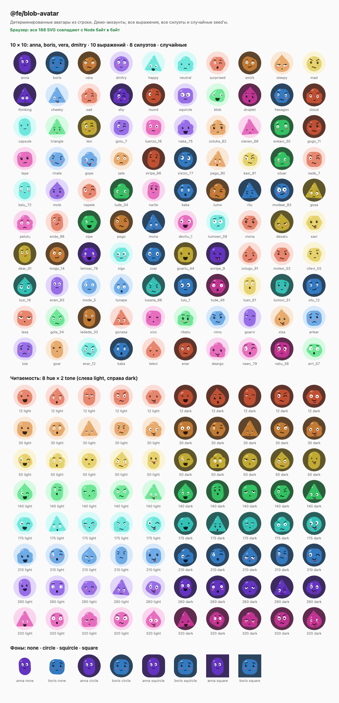

# @fe/blob-avatar

Детерминированные SVG-аватары «блобы с лицом» из любой строки (в приложении — `username`).
Чистый TypeScript без runtime-зависимостей и Vue-компонент (`vue` — peer). Один и тот же
seed даёт байт в байт одинаковый SVG в Node (SSR) и в браузере. Идея — в духе
[blobatar](https://github.com/Alain00/blobatar), код свой.



## API

```ts
import { blobAvatar, blobAvatarTree, deriveTraits } from '@fe/blob-avatar';

blobAvatar('anna');                                   // '<svg xmlns=... role="img" aria-label="anna">…</svg>'
blobAvatar('anna', { size: 48, background: 'squircle', aria: 'Анна Соколова' });
blobAvatar('anna', { traits: { expression: 'happy', hue: 210 } }); // закрепить оси
blobAvatarTree('anna');                               // SvgNode { tag, attrs, children }
deriveTraits('anna');                                 // Traits
```

- `blobAvatar(seed, options?) → string` — SVG-строка.
- `blobAvatarTree(seed, options?) → SvgNode` — дерево элементов для любого view-слоя.
- `deriveTraits(seed, overrides?) → Traits` — трейты из seed; `overrides` закрепляет любые оси
  (каждая ось тратит ровно один вызов rng в фиксированном порядке, поэтому закрепление одной
  оси не меняет остальные).
- Также экспортируются `buildTree(traits, options)`, `toSvgString(tree)`, `hashString`,
  `createRng`, `normalizeSeed`, наборы вариантов (`SHAPES`, `HUES`, `TONES`, `EYE_SHAPES`,
  `EXPRESSIONS`, `EXTRAS`) и типы.

Опции (`BlobAvatarOptions`):

| опция | тип | по умолчанию |
|---|---|---|
| `size` | `number` — `width`/`height` в px | нет атрибутов, SVG занимает 100% контейнера |
| `background` | `'none' \| 'circle' \| 'squircle' \| 'square'` | `'circle'` |
| `aria` | `string` — `aria-label` | seed (после `trim()`) |
| `traits` | `Partial<Traits>` | — |

Seed нормализуется: `trim().toLowerCase()` — `'Anna '` и `'anna'` дают одно лицо.

### Vue

```tsx
import { BlobAvatar } from '@fe/blob-avatar/vue';

<BlobAvatar seed={username} size={40} background="circle" />
<BlobAvatar seed="vera" traits={{ expression: 'happy' }} label="Вера Лисицына" />
```

Пропсы: `seed: string` (обязательный), `size?: number`, `background?`, `traits?:
Partial<Traits>`, `label?: string`. Рендер через `h()` по дереву (без `innerHTML`): SSR-safe,
гидрация совпадает с `blobAvatar()`.

## Оси (`Traits`)

| ось | варианты |
|---|---|
| `shape` | `round`, `squircle`, `blob` (гладкая кривая Catmull-Rom → Безье через 6–9 точек с джиттером), `droplet`, `hexagon`, `cloud`, `capsule`, `triangle` |
| `shapeSeed` | uint32: контур `blob` и лёгкий наклон тела (±5°) |
| `hue` | `12, 30, 50, 140, 175, 210, 260, 320` |
| `tone` | `light`, `dark` |
| `eyeShape` | `dot`, `oval`, `wide`, `wink` |
| `eyeSize`, `eyeSpacing`, `eyeTilt`, `pupilShift` | непрерывные, `0..1` |
| `expression` | `happy`, `neutral`, `surprised`, `smirk`, `sleepy`, `mad`, `thinking`, `cheeky`, `sad`, `shy` (рот и брови; `sleepy` — полуприкрытые веки, `thinking` — взгляд вверх, `shy` — всегда румянец) |
| `extras` | `blush`, `freckles`, `none` |

Итого 8 × 8 × 2 × 4 × 10 × 3 = 15 360 дискретных комбинаций плюс непрерывные параметры глаз.

## Гарантии вывода

- `viewBox="0 0 100 100"`, `role="img"`, `aria-label`; числа округлены до 2 знаков.
- Нет `id`, `<style>`, `<script>`, внешних ссылок — SVG можно вставлять на страницу много раз.
- Размер одного аватара ~1.2–2 КБ (тест держит < 4 КБ).
- Цвета — hex, вычисленные из HSL; глаза — белый белок с тёмным зрачком, читаются на любом тоне.

## Разработка

```sh
npm ci
npm test            # vitest: детерминизм, уникальность, все комбинации, снапшоты демо-аккаунтов, Vue/SSR
npm run typecheck
npm run build       # vite (lib, preserveModules) + tsc (d.ts) → dist/, коммитится
npm run gallery     # gallery.html (в .gitignore)
npm run screenshot  # gallery.html + docs/gallery.png через headless Chrome (CHROME_PATH — путь к Chrome)
```

Галерея повторно рендерит все аватары в браузере (бандл `src/index.ts`) и сравнивает строки с
Node-версией — результат в шапке страницы.

Снапшоты `tests/__snapshots__` фиксируют лица демо-аккаунтов (`anna`, `boris`, `vera`,
`dmitry`): любая правка, меняющая внешность пользователей, роняет тест — обновлять снапшот
(`npx vitest run -u`) только осознанно.
